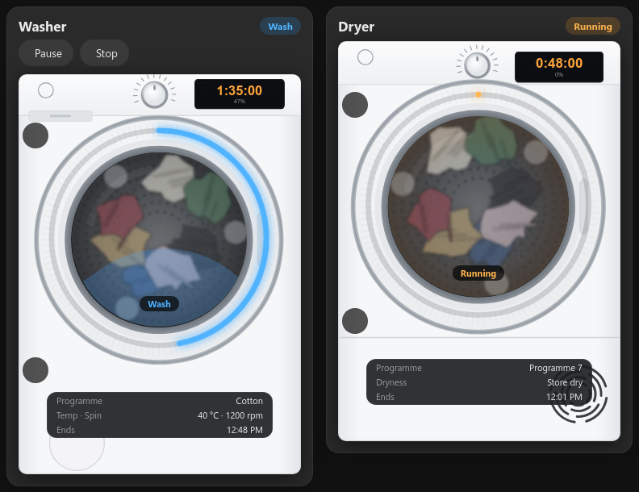
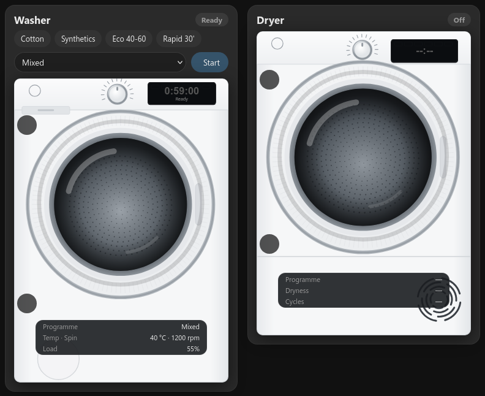
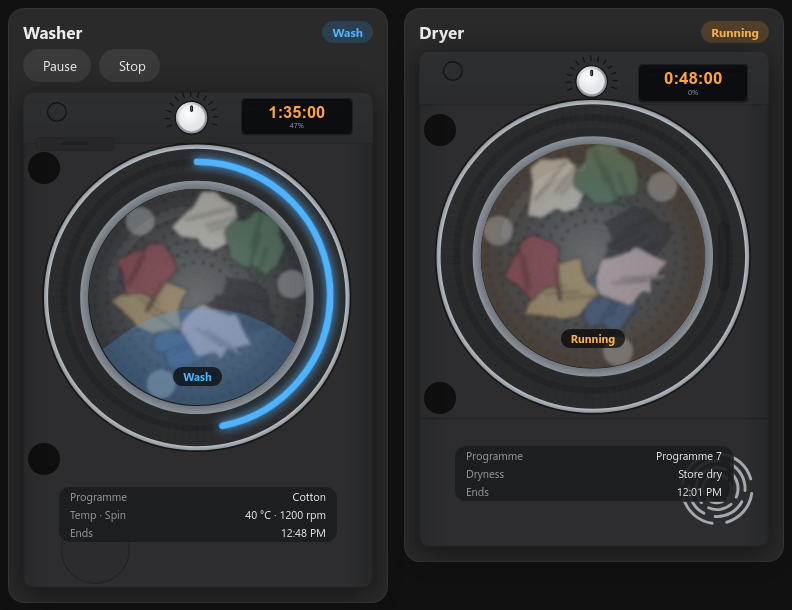

# Candy Appliance Card for Home Assistant

A washer and tumble dryer card for **Candy / Haier / Hoover Simply-Fi** machines that use the
[Candy integration by bigmoby](https://github.com/bigmoby/home-assistant-candy).

The machine is drawn on the card with a progress ring round the door, the time left on its display, and the
laundry turning while it runs. You can start, pause and stop the washer from the card.

**📖 [Step-by-step guide and live demo](https://mymediabuild.uk/home-assistant-candy-washer-dryer-card/)** · **☕ [Buy me a coffee](https://buymeacoffee.com/bobgreggr)**

> **Beta.** I don't own a Candy machine. The card is built from the integration's source code and tested against
> simulated states. If you try it, please [open an issue](../../issues) with your model and what you see.
> That's how it gets out of beta.

Sister card of the [hOn washer & dryer card](https://github.com/spikey1965/ha-hon-appliance-card) (for machines on the hOn app).



## What it shows

- Status: Ready, Running (with the wash phase), Paused, Delayed start, Finished, Error, Off
- Time left on the machine's display, the end time, and a progress ring round the door
- Programme, temperature and spin (washer) or dryness level (dryer)
- **Start**: while the washer is Idle, pick a programme (or tap a favourite) and press Start
- **Pause** and **Stop** while a cycle runs (Stop asks first)
- Notes when Remote Control is off, when the machine reports an error, and when the dryer's water tank is full or its filter needs cleaning



**Limits that come from the integration and the machine:**
- The buttons only work with **Remote Control** switched on at the machine, and with the integration in **Full Control** mode.
- Candy has no remote resume. A paused cycle has to be carried on from the machine.
- The integration has no dryer controls, so the dryer card shows status only.

## Install

**HACS:** HACS → ⋮ → Custom repositories → add `https://github.com/spikey1965/ha-candy-appliance-card`, type **Dashboard**.
Then find "Candy Appliance Card", download it, and reload the browser.

**Manual:** copy `candy-appliance-card.js` to `/config/www/`, then add a dashboard resource
(Settings → Dashboards → ⋮ → Resources): `/local/candy-appliance-card.js?v=0.1.0`, type **JavaScript module**.

## Use

```yaml
type: custom:candy-appliance-card
entity: sensor.washing_machine
favourites: [Cotton, Synthetics, Mixed]
```

```yaml
type: custom:candy-appliance-card
entity: sensor.tumble_dryer
```

`entity` is the machine's main sensor (its state is Idle, Running, Finished and so on). The card finds the
other sensors and buttons on the same device by itself, whatever you named the machine.
Without `entity`, it uses the first Candy washer it finds (or dryer, with `appliance: dryer`).

| Option | Default | What it does |
|---|---|---|
| `entity` | first Candy machine | main sensor, e.g. `sensor.washing_machine` |
| `appliance` | from the entity | `washer` or `dryer` |
| `name` | Washer / Dryer | card title |
| `colour` | blue / orange | accent colour, e.g. `"#4fb3ff"` |
| `favourites` | none | programme names exactly as in the integration's *Wash program* select, shown as quick picks |
| `show_start` | `true` | `false` hides the programme picker |
| `finish` | `white` | machine colour: `white`, `graphite` or `black` |
| `style` | `photo` | `drawn` = a simpler drawing |
| `max_width` | `440px` | |
| `images` | built in | a folder with your own `washer.svg`, `dryer.svg` and `laundry-drum.webp` |
| `entities` | found automatically | overrides if something isn't found, e.g. `phase: sensor.my_washer_wash_cycle_status` |

Keys for `entities`: `phase remaining program temp spin fill finish starts estimate error cycles remote start pause stop select`.



## Troubleshooting

- **No Start/Pause/Stop buttons:** switch Remote Control on at the machine, and check the integration is set to
  Full Control (the buttons don't exist in Read-Only mode).
- **Something shows "—":** open Developer Tools → States, search for your machine, and set that entity under `entities:`.
  Then please open an issue with the entity list so the card can find it next time.
- **Dryer programme shows a number:** that's what the integration reports for dryers.

## Support and requests

I build and look after this card in my spare time.

- **Found a bug?** [Open an issue](../../issues/new/choose) and fill in the form. A screenshot and the entity list help a lot.
- **Want another brand or integration?** Pull requests are very welcome. I can only test machines I own, so I can't promise to add new ones myself. Use the "Support for another machine" form so all the details are in one place.
- **Like the card?** A ⭐ on GitHub helps other people find it, and you can [buy me a coffee](https://buymeacoffee.com/bobgreggr) ☕. More free Home Assistant cards and guides at [mymediabuild.uk](https://mymediabuild.uk).

## Credits

[bigmoby/home-assistant-candy](https://github.com/bigmoby/home-assistant-candy) does all the talking to the machine.
Card by [My Media Build](https://mymediabuild.uk). MIT licence. If it's useful, you can
[buy me a coffee](https://buymeacoffee.com/bobgreggr).
